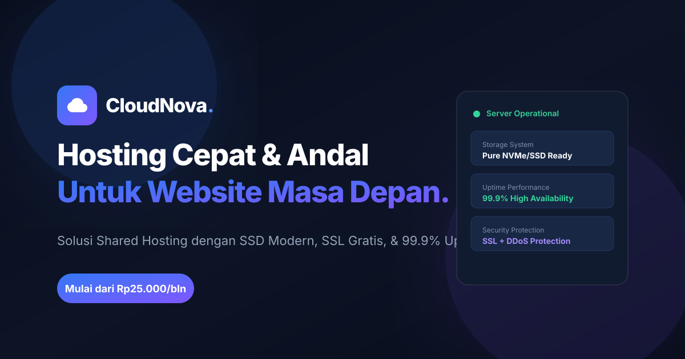

# ☁️ CloudNova Hosting — Premium Web Hosting Platform

<p align="center">
  
</p>

<p align="center">
  <strong>Solusi Web Hosting Cepat, Aman, dan Terjangkau untuk Website Masa Depan.</strong><br>
  Proyek Website Iklan & Layanan Hosting berbasis <strong>Next.js (React + TypeScript + Tailwind CSS)</strong> dan <strong>HTML5 Modern</strong>.
</p>

<p align="center">
  
  
  
  
  
</p>

---

## 📌 Tentang Proyek

**CloudNova Hosting** adalah platform landing page dan sistem pemesanan hosting modern yang dirancang khusus untuk promosi layanan *Shared Hosting*, pendaftaran domain, dan monitoring infrastruktur server. Proyek ini memadukan desain UI *dark tech premium* dengan pengalaman checkout interaktif ala penyedia hosting global ternama (seperti Hostinger).

Proyek ini tersedia dalam 2 implementasi:
1. **Next.js App (`cloudnova-app/`)**: Implementasi berbasis fullstack React modern dengan App Router, TypeScript, dan Tailwind CSS.
2. **Static Web (`/`)**: Implementasi HTML5, CSS3 kustom, Bootstrap 5, dan Vanilla JavaScript siap pakai tanpa perlu runtime server.

---

## ✨ Fitur Unggulan

### 1. 🌐 Live Domain Checker (Hero Section)
* Input pencarian domain interaktif dengan chip ekstensi instan (`.com`, `.id`, `.co.id`, `.net`, `.org`).
* Validasi simulasi ketersediaan domain yang langsung mengaitkan nama domain ke halaman checkout.

### 2. ⚡ Hosting Advisor (Kalkulator Kebutuhan Hosting)
* Widget rekomendasi paket otomatis berdasarkan:
  * **Perkiraan Pengunjung Bulanan:** (< 10.000, 10.000–50.000, > 50.000 pengunjung).
  * **Tipe Website:** (Blog Pribadi, Toko Online/UMKM, Web Agensi/Portal Berita).
* Memberikan saran paket yang paling pas secara finansial dan performa.

### 3. 💳 Checkout Interaktif ala Hostinger (`/cart`)
* **Pemilih Durasi Fleksibel:** Pilihan siklus sewa 1, 12, 24, hingga 48 bulan dengan diskon bertingkat hingga 50%.
* **Sistem Kupon Promo:** Input kupon dinamis (`SEMESTER7`, `CLOUDFIRST`, `MABA2026`) dengan kalkulasi potongan harga *realtime*.
* **Pilihan Metode Pembayaran:**
  * 📱 **QRIS Instan** (GoPay, OVO, Dana, ShopeePay)
  * 🏦 **Virtual Account Bank** (BCA, Mandiri, BRI, BNI)
  * 💵 **Transfer Bank Manual**
* **Otomasi WhatsApp Order:** Tombol checkout merangkum seluruh rincian pesanan (paket, durasi, domain, metode bayar, data pemesan, dan total PPN 11%) ke format pesan WhatsApp siap kirim.

### 4. 📊 Status & Uptime Server Realtime (`/status`)
* **SLA Uptime Monitor:** Indikator ketersediaan server dengan target 99.98%.
* **Datacenter Node Status:**
  * 🇮🇩 **Node ID-01 (Cyber 2 Jakarta)**: Latensi 4 ms (IIX).
  * 🇸🇬 **Node SG-01 (Equinix Singapore)**: Latensi 18 ms regional.
  * 🛡️ **Storage & Backup Vault**: Sinkronisasi snapshot harian.
* **Service Breakdown:** Status operasional LiteSpeed Web Server, MySQL Database, cPanel, Mail Server, dan AutoSSL.

### 5. 🔍 SEO & Legalitas Lengkap
* Schema Markup Structured Data (JSON-LD) untuk `Organization` dan `FAQPage`.
* OpenGraph & Twitter Card Meta Tags lengkap dengan aset `og-image.svg`.
* Halaman legalitas: Syarat & Ketentuan (`/tos`) dan Kebijakan Privasi (`/privacy`).
* File konfigurasi crawler: `robots.txt` dan `sitemap.xml`.

---

## 🛠️ Tech Stack & Arsitektur

| Komponen | Teknologi |
| :--- | :--- |
| **Framework** | Next.js (App Router) |
| **Bahasa** | TypeScript, JavaScript (ES6+) |
| **Styling** | Tailwind CSS v4, Bootstrap Icons |
| **Typography** | Inter (Google Fonts) |
| **Integrasi Pesanan** | WhatsApp Business Click-to-Chat API |
| **Runtime** | Node.js (LTS) |

---

## 📁 Struktur Direktori

```text
CloudNova Hosting/
├── cloudnova-app/               # 🚀 Project Next.js (Modern Framework)
│   ├── public/                  # Aset gambar, ikon, dan og-image
│   ├── src/
│   │   ├── app/
│   │   │   ├── cart/page.tsx    # Halaman checkout & kalkulator durasi
│   │   │   ├── status/page.tsx  # Halaman pemantauan status server
│   │   │   ├── layout.tsx       # Root layout & konfigurasi SEO
│   │   │   └── page.tsx         # Landing page utama & advisor
│   │   └── components/
│   │       ├── Navbar.tsx       # Komponen navbar responsif
│   │       └── Footer.tsx       # Komponen footer lengkap
│   ├── package.json
│   └── tsconfig.json
│
├── assets/                      # Aset statis CSS, JS, dan Gambar
├── index.html                   # Versi HTML Landing Page
├── cart.html                    # Versi HTML Checkout
├── status.html                  # Versi HTML Status Server
├── tos.html & privacy.html      # Halaman hukum dan privasi
├── robots.txt & sitemap.xml     # Konfigurasi SEO
└── start-nextjs.bat             # Shortcut sekali klik untuk menjalankan Next.js
```

---

## 🚀 Panduan Menjalankan Proyek

### Opsi A: Menjalankan Versi Next.js (Rekomendasi)

#### 1. Cara Cepat (Windows)
Cukup **double-click** file:
```text
start-nextjs.bat
```

#### 2. Melalui Terminal / Command Prompt
```bash
# 1. Masuk ke folder aplikasi Next.js
cd cloudnova-app

# 2. Instal dependensi (jika belum diinstal)
npm install

# 3. Jalankan server development
npm run dev
```
Buka browser Anda dan akses: **`http://localhost:3000`**

---

### Opsi B: Menjalankan Versi Statis (Tanpa Node.js)
Buka file **`index.html`** langsung melalui browser apa pun atau gunakan extension **Live Server** di VS Code.

---

## 🎟️ Kode Kupon Promo untuk Demo

Untuk mendemokan fitur kalkulator diskon di halaman checkout (`/cart`), Anda dapat memasukkan kode kupon berikut:

| Kode Kupon | Potongan | Keterangan |
| :--- | :---: | :--- |
| `SEMESTER7` | **15%** | Promo spesial mahasiswa |
| `CLOUDFIRST` | **20%** | Promo pelanggan baru |
| `MABA2026` | **10%** | Promo edukasi |

---

## 👨‍💻 Kontribusi & Lisensi

Proyek ini dikembangkan sebagai prototipe rintisan layanan hosting Indonesia dan pemenuhan tugas akademik.

&copy; 2026 **CloudNova Hosting**. All Rights Reserved.
